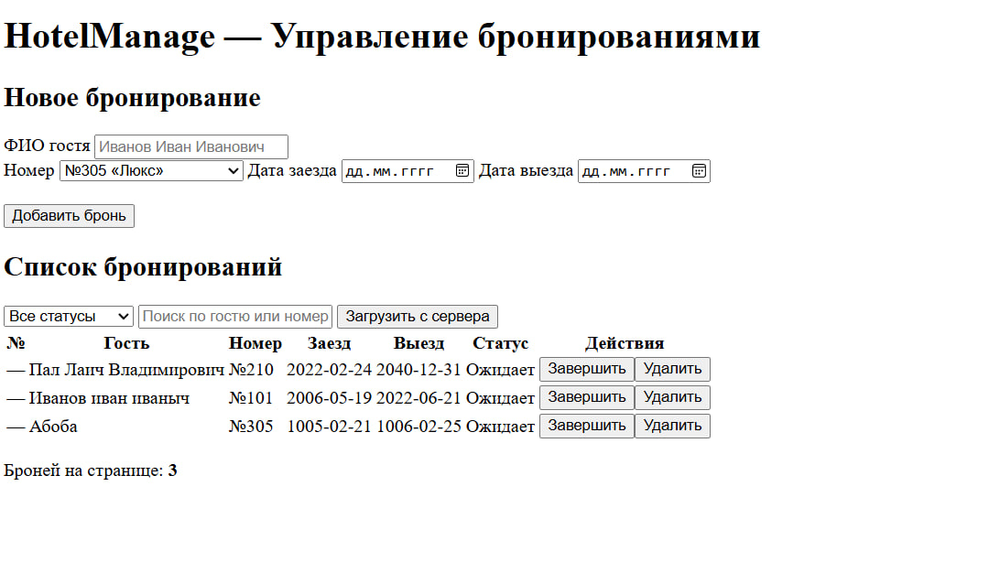
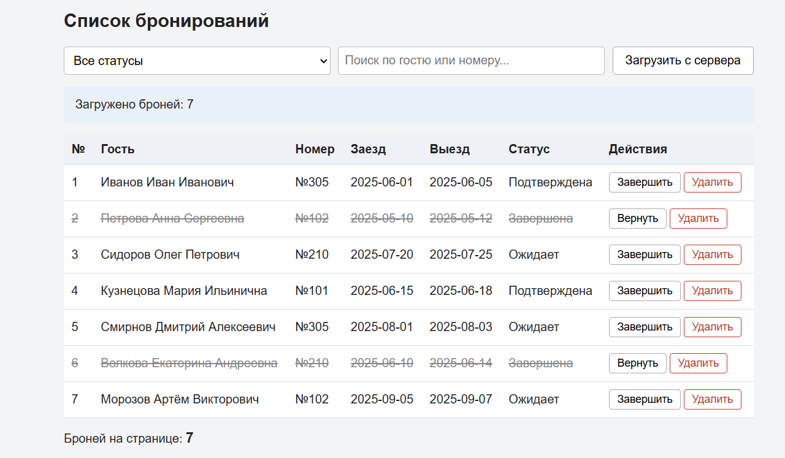
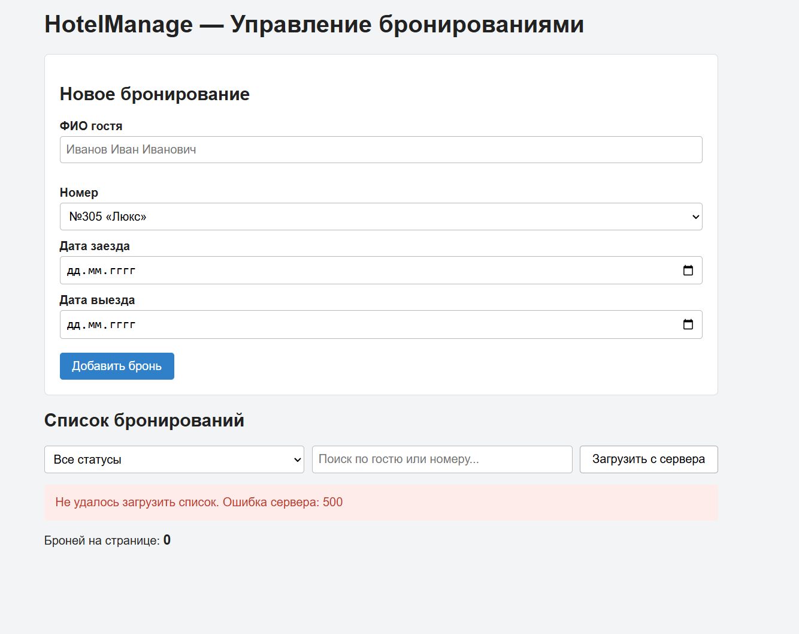

# Лабораторная работа №5
## Реализация клиентской логики информационной системы управления номерным фондом гостиницы

### Цель работы

Изучить основы разработки клиентской части веб-приложений, реализовать обработку пользовательских событий, взаимодействие с сервером посредством асинхронных запросов и динамическое изменение содержимого веб-страницы с использованием JavaScript.

---

## Краткое описание выполненного задания

На основе пользовательского интерфейса системы «Управление номерным фондом гостиницы» (лабораторная работа №4) реализована клиентская логика на HTML, CSS и чистом JavaScript (без библиотек и фреймворков). Страница показывает список бронирований, позволяет искать и фильтровать их по статусу и гостю, добавлять новые брони, отмечать их завершёнными и удалять.

Серверной части пока нет, поэтому данные берутся из учебного сервера, который работает в браузере. В `src/js/mock-data.js` описаны массивы с данными (`bookings`, `rooms`) и таблица `ROUTES` («какой запрос — какие данные возвращает»), а `src/js/mock-api.js` — «движок», который перехватывает запросы `fetch` к адресам `/api/...` и отвечает как настоящий REST API (с задержкой, кодом ответа и JSON).

**Запуск:** открыть файл `src/index.html` в браузере двойным щелчком. Веб-сервер не требуется.

---

## Описание реализованной клиентской логики

Вся логика находится в файле `src/js/app.js`:

| Блок | Назначение |
|------|------------|
| поиск элементов страницы | `document.getElementById(...)` по `id` из `index.html` (`booking-form`, `booking-guest`, `booking-room`, `booking-checkin`, `booking-checkout`, `status-filter`, `search-input`, `refresh-button`) |
| `showInfo()`, `updateCounter()`, `addCell()` | вспомогательные функции для вывода сообщений, обновления счётчика и создания ячеек |
| `createBookingRow()` | создание строки таблицы для одного бронирования |
| `onFormSubmit()`, `onDoneClick()`, `onDeleteClick()` | обработчики событий |
| `loadBookings()`, `refreshList()` | запрос к серверу и вывод полученных данных |

Страница работает по схеме «событие → действие → результат на странице»: пользователь выполняет действие, обработчик меняет содержимое страницы, перезагрузки страницы не происходит.

![Список бронирований после загрузки с сервера]

Список загружается автоматически при открытии страницы (вызов `refreshList()` в конце `app.js`) и повторно по кнопке «Загрузить с сервера».

---

## Описание обработки пользовательских событий

| Событие | Элемент | Что происходит |
|---------|---------|----------------|
| `submit` | форма «Новое бронирование» | отмена перезагрузки страницы (`preventDefault`), проверка ФИО гостя (не короче 3 символов), добавление строки в таблицу, очистка формы |
| `click` | кнопка «Загрузить с сервера» | запрос к серверу и обновление таблицы |
| `change` | список «Все статусы» | запрос с выбранным статусом (`new` / `in_progress` / `done`) и обновление таблицы |
| `input` | поле поиска | запрос с введённым текстом (поиск по ФИО гостя и номеру) и обновление таблицы |
| `click` | кнопка «Завершить» / «Вернуть» в строке | бронь отмечается завершённой или возвращается в работу |
| `click` | кнопка «Удалить» в строке | подтверждение и удаление строки со страницы |

Обработчики кнопок в строках подключаются в момент создания строки (`addEventListener` внутри `createBookingRow`), потому что строки появляются на странице динамически.

---

## Описание работы с DOM и асинхронными запросами

### Работа с DOM

| Операция | Где в коде | Пример |
|----------|------------|--------|
| создание новых элементов | `createBookingRow()`, `addCell()` | `document.createElement('tr')`, `appendChild`, `insertBefore` |
| удаление элементов | `onDeleteClick()` | `row.remove()` |
| изменение текста | `onDoneClick()`, `showInfo()`, `updateCounter()` | `row.children[5].textContent = 'Завершена'` |
| изменение атрибутов | `createBookingRow()`, `onDoneClick()`, `updateCounter()` | `row.setAttribute('data-id', ...)`, `button.setAttribute('title', ...)`, `bookingTable.hidden = true` |
| изменение классов оформления | `createBookingRow()`, `onDoneClick()` | `row.classList.toggle('done')` |

Строка таблицы бронирования содержит 7 ячеек: №, Гость, Номер, Заезд, Выезд, Статус, Действия. Статус в ячейке отображается через словарь `STATUS_NAMES` (`new → Ожидает`, `in_progress → Подтверждена`, `done → Завершена`).

Весь текст, в том числе введённый пользователем, записывается через `textContent`, поэтому внедрить HTML-код через ФИО гостя невозможно (проверено на строке `<b>Тест</b>`: она отображается как обычный текст).

![Страница после добавления брони и отметки «Завершить»]
На снимке добавлена новая бронь (номер «—», пока она не сохранена на сервере) и кнопкой «Завершить» отмечены брони №2 и №6. Брони №1 и №4 были подтверждены в исходных данных. У всех завершённых строк добавлен класс `done` (текст зачёркнут), у их кнопок изменён текст на «Вернуть». Счётчик под таблицей обновляется при каждом добавлении и удалении.

### Асинхронные запросы

Запрос выполняется функцией `loadBookings()`:

```js
const url = '/api/bookings?status=' + status + '&q=' + encodeURIComponent(text);
const response = await fetch(url);
if (!response.ok) {
  throw new Error('Ошибка сервера: ' + response.status);
}
return await response.json();
```

Функция `refreshList()` управляет состояниями страницы:

| Состояние | Что видит пользователь |
|-----------|------------------------|
| загрузка | сообщение «Загрузка…», кнопка «Загрузить с сервера» заблокирована (`refreshButton.disabled = true`) |
| данные получены | таблица со строками и сообщение «Загружено броней: N» |
| данных нет | сообщение «Бронирования не найдены», таблица скрыта, счётчик 0 |
| ошибка | красное сообщение (для сети — «Нет связи с сервером», иначе — «Не удалось загрузить список. …») |

Блок `finally` гарантирует, что кнопка снова станет доступной при любом исходе запроса.

![Сообщение об ошибке сети]

### Запросы к API

| Метод | Адрес | Где используется | Ответ |
|-------|-------|------------------|-------|
| GET | `/api/bookings?status=&q=` | `loadBookings()`: загрузка, фильтр по статусу, поиск по гостю/номеру (пустые значения означают «без фильтра») | 200 массив бронирований |
| GET | `/api/rooms` | зарезервирован для расширения (список номеров) | 200 массив номеров |

### Проверка работы приложения

Проверка выполнена вручную, в том числе в «плохих условиях» с помощью команд `MockApi`:

| Сценарий | Как воспроизведён | Результат |
|----------|-------------------|-----------|
| Загрузка при открытии страницы | открытие `index.html` | 7 броней, таблица и счётчик обновлены |
| Фильтр по статусу | выбор «Завершена» | в таблице 2 брони без перезагрузки страницы |
| Поиск | ввод «Иванов» | в таблице 1 бронь |
| Пустой результат | ввод «zzz» | сообщение «Бронирования не найдены», таблица скрыта, счётчик 0 |
| Ошибка в форме | отправка пустой формы (ФИО короче 3 символов) | красная подсказка под полем, строка не добавляется |
| Добавление, отметка, удаление | работа с формой и кнопками | строка создаётся, получает/теряет класс `done`, удаляется, счётчик актуален |
| Медленный сервер | `MockApi.setDelay(2000, 3000)` | виден текст «Загрузка…», кнопка недоступна |
| Сбой сервера | `MockApi.setErrorRate(1)` | красное сообщение с кодом ошибки 500 |
| Нет сети | `MockApi.setNetworkDown(true)` | красное сообщение «Нет связи с сервером», кнопка снова доступна; после `setNetworkDown(false)` повторное нажатие возвращает список |
| Неверный адрес | замена `/api/bookings` на `/api/bookingsX` | красное сообщение об ошибке 404, страница не ломается |

После проверки возвращён нормальный режим:
```js
MockApi.setDelay(300, 800);
MockApi.setErrorRate(0);
MockApi.setNetworkDown(false);
```

---

## Соответствие критериям проверки

| № | Критерий | Где реализовано |
|---|----------|-----------------|
| 1 | Обработка пользовательских событий средствами JavaScript (`submit`, `click`, `change`, `input`) | `onFormSubmit`, `onDoneClick`, `onDeleteClick`, `refreshList` + `addEventListener` в конце `app.js` |
| 2 | Работа с DOM: создание, удаление, изменение текста, атрибутов и классов | `createBookingRow`, `addCell`, `row.remove()`, `row.children[5].textContent`, `setAttribute`, `classList.toggle('done')` |
| 3 | Асинхронные запросы `fetch` с проверкой ответа, обработкой ошибок, состояний загрузки и пустого результата | `loadBookings()` (`response.ok`), `refreshList()` (`try/catch/finally`, `showInfo`) |
| 4 | Оформление репозитория и описание реализации | данный README.md + скриншоты в `images/` |

---

## Вывод

В результате работы реализована клиентская логика страницы системы управления номерным фондом гостиницы. Освоены обработка пользовательских событий (`click`, `submit`, `change`, `input`), динамическое изменение содержимого страницы средствами DOM (создание и удаление элементов, изменение текста, атрибутов и классов) и получение данных с сервера с помощью асинхронных запросов `fetch` с обработкой ошибок и состояний загрузки. Интерфейс обновляется без перезагрузки страницы. Запросы к серверу выполняются так же, как к настоящему API, поэтому при подключении серверной части в следующих работах код страницы почти не изменится.

---

**Структура репозитория:**
```
lab5/
├── README.md
├── src/
│   ├── index.html
│   ├── css/
│   │   └── styles.css
│   └── js/
│       ├── mock-data.js
│       ├── mock-api.js
│       └── app.js
├── images/
│   ├── 01-list.png
│   ├── 02-dom.png
│   └── 03-error.png
└── extended/