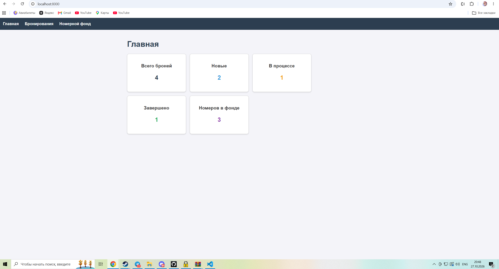
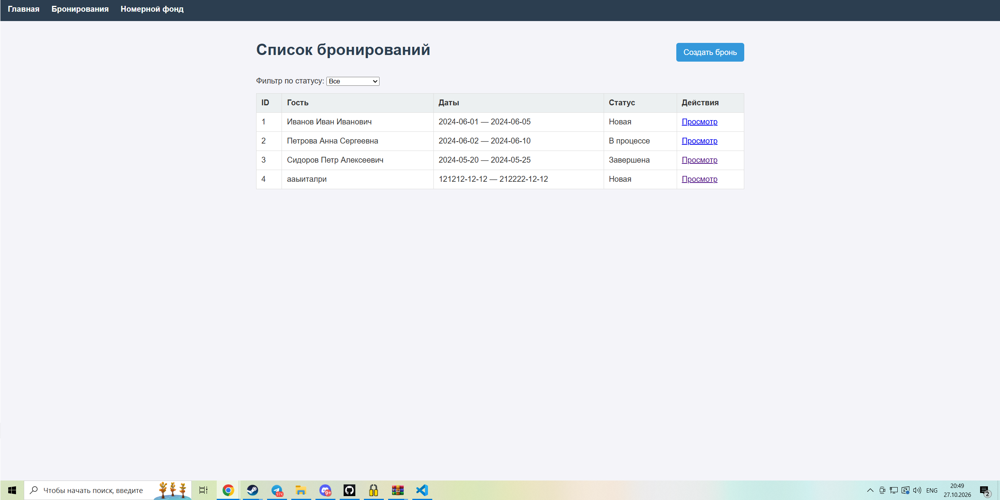
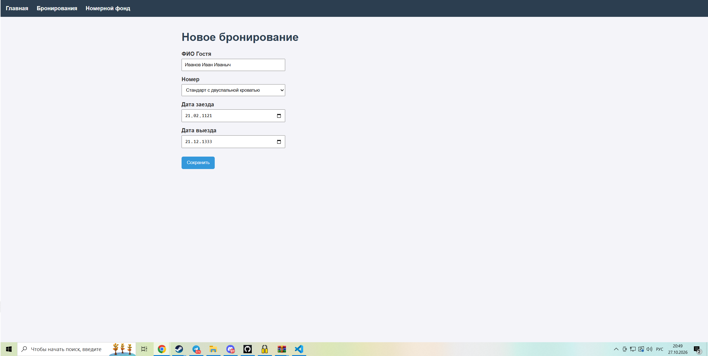
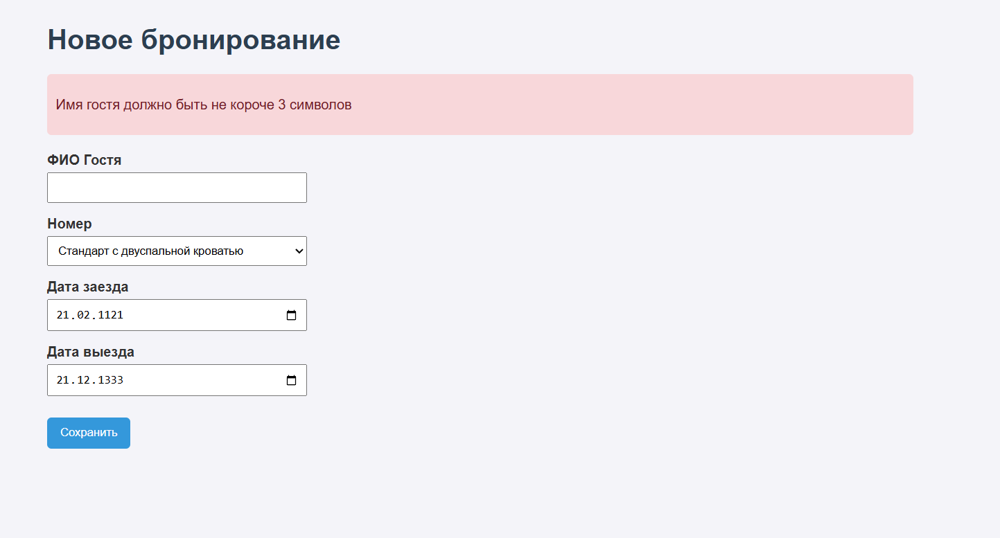
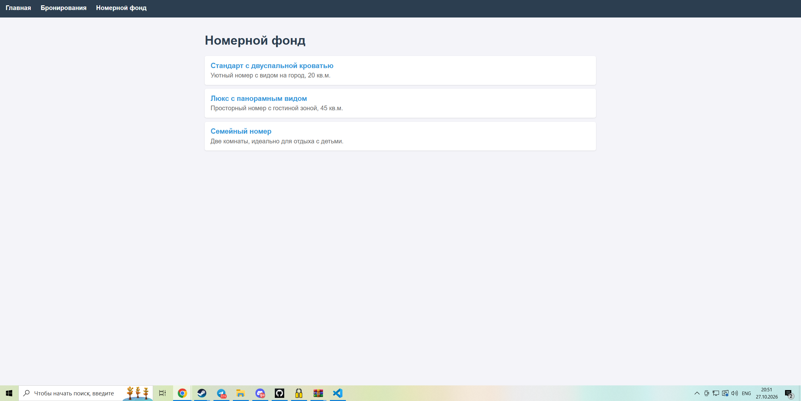
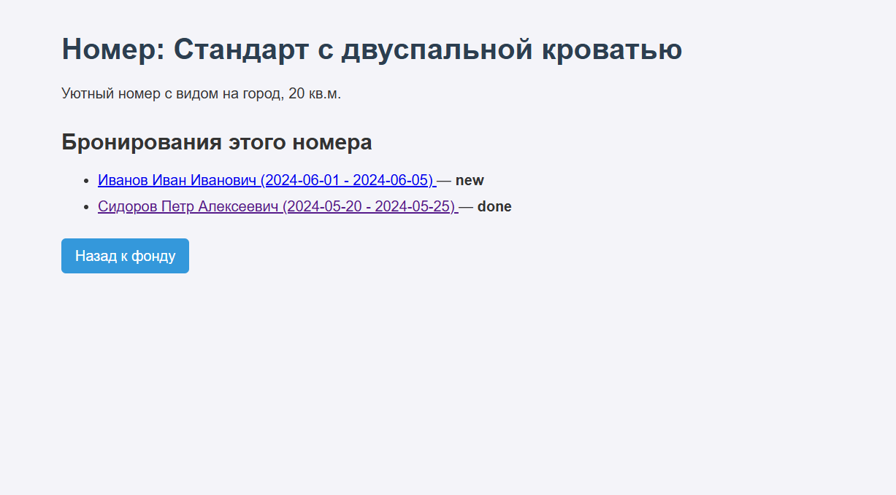
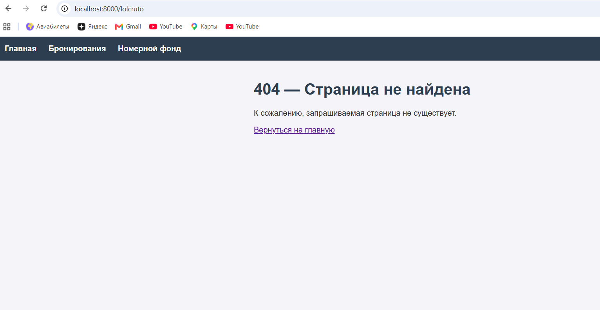

# Лабораторная работа №6

## Разработка серверной части приложения

### Цель работы

Изучить основы разработки серверной части веб-приложений на PHP, создать структуру проекта, реализовать маршрутизацию HTTP-запросов и разработать контроллеры для обработки запросов пользователей.

---

## Краткое описание выполненного задания

На основе архитектуры системы «Управление номерным фондом гостиницы» (лабораторные работы №3–5) создана основа серверной части приложения на PHP 8.2 по паттерну MVC: единая точка входа, собственный маршрутизатор, три контроллера, модели и HTML-шаблоны. 

Сервер отвечает страницами: главная со сводкой, список бронирований с фильтром, просмотр брони, форма создания, список номеров и просмотр конкретного номера.

Данные хранятся в JSON-файлах (`src/storage/`), работа с ними вынесена в модели. База данных будет подключена в следующих работах: контроллеры и шаблоны при этом менять не потребуется.

## Предметная область

Вариант: «Управление номерным фондом гостиницы».

| Что определить | Значение |
| :--- | :--- |
| Основная сущность | бронирование (`booking`, `bookings`) |
| Связанная сущность | номер (`room`, `rooms`) |
| Поля основной сущности | `id`, `room_id`, `guest_name`, `check_in`, `check_out`, `status` |
| Поле для фильтра | `status`: `new`, `in_progress`, `done` |
| Поля связанной сущности | `id`, `title`, `description` |
| Данные | 3 брони, 3 номера (`storage/bookings.json`, `storage/rooms.json`) |

---

## Запуск приложения

```bash
cd lab6/src
php -S localhost:8000 -t public

src/
├── public/                       # единственная папка, доступная из интернета
│   ├── index.php                 # единая точка входа (front controller)
│   └── css/style.css
├── app/
│   ├── autoload.php              # автозагрузка классов по пространству имён
│   ├── helpers.php               # функции e(), view(), redirect(), notFound(), config()
│   ├── Core/Router.php           # маршрутизатор
│   ├── Controllers/              # HomeController, BookingController, RoomController
│   ├── Models/                   # BookingRepository, RoomRepository
│   └── Views/                    # шаблоны: layout/, errors/, bookings/, rooms/, home.php
├── routes/web.php                # таблица маршрутов
├── config/app.php                # настройки
└── storage/                      # данные: bookings.json, rooms.json

```

**Назначение каталогов:**

| Каталог | Назначение |
| :--- | :--- |
| `public/` | точка входа и статические файлы. Только эта папка открыта серверу (`-t public`), поэтому код и данные недоступны по прямому адресу |
| `app/Controllers/` | контроллеры: принимают запрос, обращаются к моделям, выбирают шаблон |
| `app/Models/` | модели: единственное место, которое знает, где и как хранятся данные |
| `app/Views/` | шаблоны страниц (PHP внутри HTML), общая шапка и подвал вынесены в `layout/` |
| `app/Core/` | ядро приложения: маршрутизатор |
| `routes/` | таблица соответствия «адрес — контроллер и метод» |
| `config/` | настройки приложения |
| `storage/` | файлы с данными |

Классы подключаются автоматически: функция `spl_autoload_register` по имени класса `App\Controllers\BookingController` находит файл `app/Controllers/BookingController.php`, поэтому в коде нет ни одного `require` для классов.

## Описание механизма маршрутизации

Все запросы направляются в `public/index.php` (front controller). Он подключает автозагрузку и вспомогательные функции, создаёт `Router`, загружает таблицу маршрутов `routes/web.php` и передаёт маршрутизатору метод и адрес запроса.

**Таблица маршрутов:**

| Метод | Адрес | Контроллер и метод | Назначение |
| :--- | :--- | :--- | :--- |
| GET | `/` | `HomeController::index` | главная страница |
| GET | `/bookings` | `BookingController::index` | список броней |
| GET | `/bookings/create` | `BookingController::create` | форма создания |
| POST | `/bookings` | `BookingController::store` | приём формы |
| GET | `/bookings/{id}` | `BookingController::show` | просмотр брони |
| GET | `/rooms` | `RoomController::index` | список номеров |
| GET | `/rooms/{id}` | `RoomController::show` | просмотр номера |

**Алгоритм `Router::dispatch()`:**

1. Из адреса `/bookings/5?status=done` выделяется путь `/bookings/5`.
2. Маршруты просматриваются **по порядку**. Пропускаются маршруты с другим методом.
3. Для маршрута с подходящим методом метод `match()` превращает шаблон `/bookings/{id}` в регулярное выражение и возвращает параметры (`['id' => '5']`) или `null`, если адрес не подошёл.
4. Для подошедшего маршрута создаётся объект контроллера, и вызывается его метод, а параметры из адреса передаются как именованные аргументы (`show(string $id)`).
5. Если подходящего маршрута нет, возвращается страница 404 с кодом ответа 404.

Порядок регистрации важен: маршрут `/bookings/create` зарегистрирован выше `/bookings/{id}`. Иначе слово `create` было бы принято за номер брони.

Ошибки выполнения (исключения) перехватываются в `public/index.php`: приложение возвращает код 500 и страницу ошибки. Подробный текст ошибки показывается только при `debug = true` в `config/app.php`.

## Описание реализованных контроллеров

| Контроллер | Метод | Что делает |
| :--- | :--- | :--- |
| `HomeController` | `index` | считает брони по статусам и общее количество номеров, показывает главную |
| `BookingController` | `index` | список броней; при `?status=done` оставляет только выбранный статус |
| `BookingController` | `show($id)` | одна бронь и информация о номере; если брони нет, страница 404 |
| `BookingController` | `create` | форма создания с выпадающим списком номеров |
| `BookingController` | `store` | читает `$_POST`, проверяет данные; при ошибках показывает форму с подсказками и кодом 422, иначе сохраняет бронь и перенаправляет на `/bookings` (код 302) |
| `RoomController` | `index` | список номеров |
| `RoomController` | `show($id)` | номер и список его броней; если номера нет, страница 404 |

Передача данных между слоями:

*   **маршрутизатор → контроллер:** параметры адреса (`{id}`) как аргументы метода;
*   **запрос → контроллер:** `$_GET` (фильтр) и `$_POST` (форма);
*   **контроллер → шаблон:** функция `view('bookings/show', ['booking' => $booking, ...])`, ключи массива становятся переменными в шаблоне;
*   **модель → контроллер:** массивы данных (`all()`, `find()`, `byStatus()`, `add()`).

Все значения в шаблонах выводятся через функцию `e()` (`htmlspecialchars`), поэтому внедрить HTML-код через имя гостя невозможно.

---

## Проверка работы приложения

| Запрос | Результат |
| :--- | :--- |
| `GET /` | 200, карточки: 3 брони, 1 новая, 1 в процессе, 1 завершена, 3 номера |
| `GET /bookings` | 200, 3 строки |
| `GET /bookings?status=done` | 200, 1 строка |
| `GET /bookings?status=zzz` | 200, сообщение «Бронирования не найдены» |
| `GET /bookings/2` | 200, данные брони №2 и название номера |
| `GET /bookings/999` | 404 |
| `GET /bookings/create` | 200, форма (маршрут не перехвачен шаблоном `{id}`) |
| `POST /bookings` с именем «Да» | 422, подсказки у полей, введённое значение сохранено |
| `POST /bookings` с корректными данными | 302 → 200 на `/bookings`, новая бронь в списке и в `storage/bookings.json` |
| `GET /rooms` | 200, список из 3 номеров |
| `GET /rooms/1` | 200, номер и список его броней |
| `GET /rooms/99`, `GET /nonexistent` | 404 |
| `GET /css/style.css` | 200 (статика отдаётся сервером напрямую) |

## Главная страница

## Бронирования

## Создать бронь

## Ошибка создания

## Гостевой фонд

## Параметры комнаты

## 404 ошибка


## Вывод

В результате работы создана основа серверной части приложения на PHP по паттерну MVC: определена структура проекта, реализован маршрутизатор, который регистрирует маршруты, выбирает контроллер по методу и адресу, передаёт ему параметры из адреса и возвращает страницу 404 для несуществующих маршрутов.

Разработаны три контроллера (`HomeController`, `BookingController`, `RoomController`), обрабатывающие основные сценарии: просмотр главной страницы, списков и отдельных объектов, создание объекта через форму с проверкой данных на сервере. Также реализованы модели для работы с JSON-файлами (`BookingRepository`, `RoomRepository`), которые изолируют логику хранения данных от остального кода.

Все данные в шаблонах выводятся через функцию `e()` (`htmlspecialchars`), что предотвращает XSS-атаки. Разделение на модели, представления и контроллеры позволит в следующей лабораторной работе заменить файловое хранилище на базу данных и добавить REST API, не переписывая логику контроллеров и шаблонов.

## Структура репозитория

```text
lab6/
├── README.md
├── src/          # исходный код (см. «Описание структуры проекта»)
└── images/
    ├── 01-home.png
    ├── 02-bookings.png
    ├── 03-booking.png
    ├── 04-create-errors.png
    ├── 05-rooms.png
    └── 06-404.png        