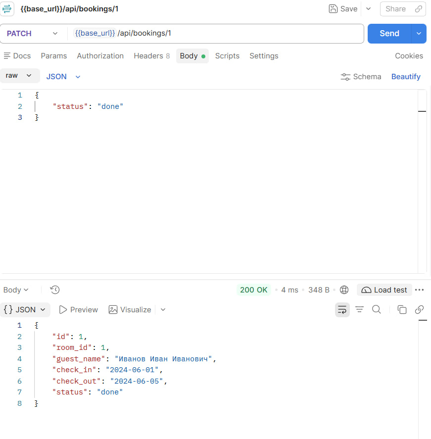
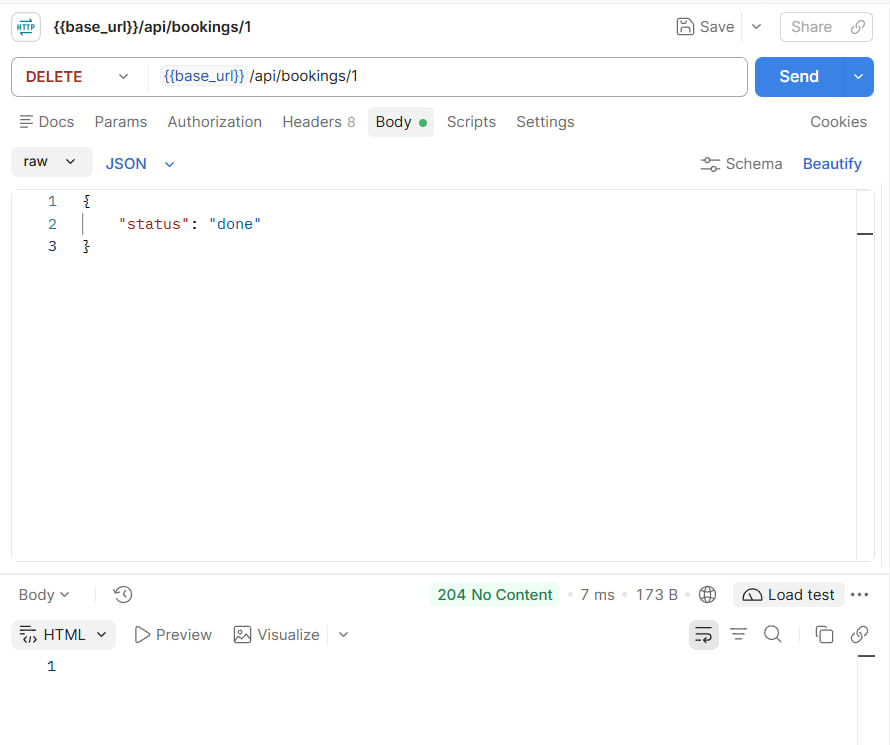
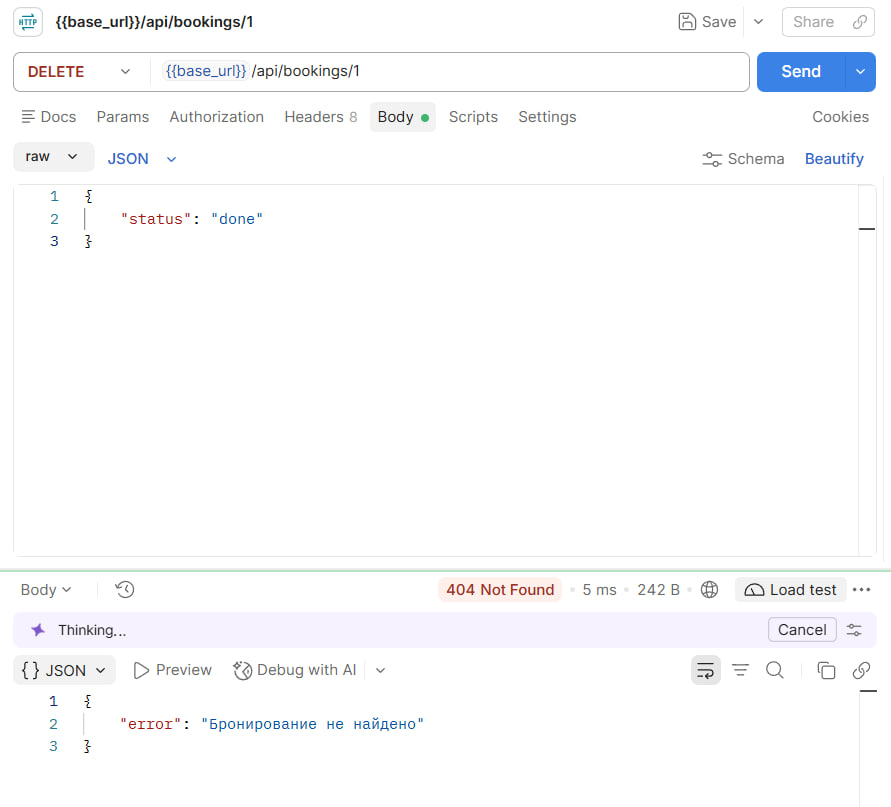
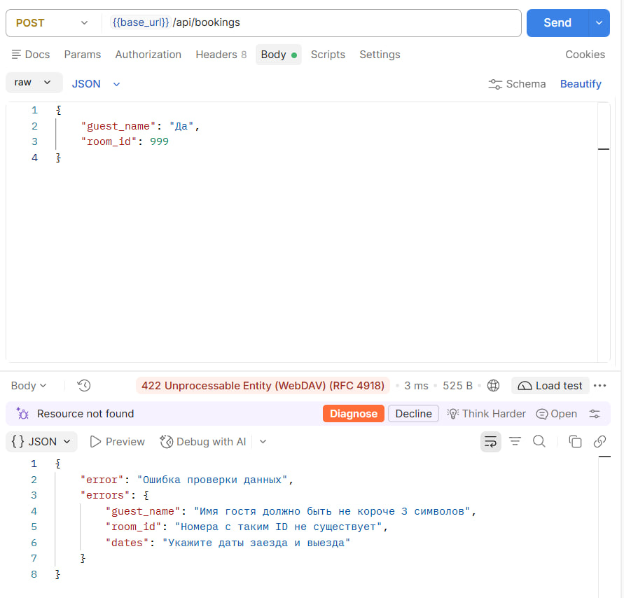

# Лабораторная работа №7
## Проектирование REST API

### Цель работы

Изучить принципы проектирования REST API, разработать набор ресурсов информационной системы, реализовать основные HTTP-методы, подготовить документацию API и выполнить тестирование запросов.

---

## Краткое описание выполненного задания

На основе серверной части из лабораторной работы №6 («Управление номерным фондом гостиницы», PHP 8.2, MVC) реализован REST API с тремя ресурсами: бронирования, номера, гости. Для каждого ресурса поддержаны операции CRUD через методы `GET`, `POST`, `PUT`/`PATCH`, `DELETE`; ответы возвращаются в формате JSON с корректными кодами состояния (200, 201, 204, 400, 404, 405, 409, 422, 500). Сайт из лабораторной работы №6 продолжает работать.

## Предметная область

Вариант: «Управление номерным фондом гостиницы».

| Что определить | Значение |
|----------------|----------|
| Основная сущность | бронирование (`booking`, `bookings`) |
| Связанная сущность | номер (`room`, `rooms`) |
| Третья сущность | гость (`guest`, `guests`) |
| Поля основной сущности | `id`, `room_id`, `guest_name`, `check_in`, `check_out`, `status` (`new`, `in_progress`, `done`) |
| Поля третьей сущности | `id`, `name`, `phone`, `email` |

---

## Запуск:

```bash
cd lab7/src
php -S localhost:8000 -t public
```
## Описание реализованных ресурсов

| Ресурс | URL | Методы | Назначение | Формат данных |
| :--- | :--- | :--- | :--- | :--- |
| Бронирования | `/api/bookings`, `/api/bookings/{id}` | GET, POST, PUT/PATCH, DELETE | учёт броней | `id, room_id, guest_name, check_in, check_out, status` |
| Номера | `/api/rooms`, `/api/rooms/{id}` | GET, POST, PUT/PATCH, DELETE | номерной фонд | `id, title, description` |
| Гости | `/api/guests`, `/api/guests/{id}` | GET, POST, PUT/PATCH, DELETE | база гостей | `id, name, phone, email` |

Адреса — существительные во множественном числе; действие определяется HTTP-методом; фильтры передаются строкой запроса (`?status=done`).

## Описание REST API

Полная документация с параметрами, примерами запросов и ответов: [docs/api.md](./docs/api.md). Сводная таблица:

| Метод | URL | Назначение | Успешный код |
| :--- | :--- | :--- | :--- |
| GET | `/api/bookings` | список броней (`status`) | 200 |
| GET | `/api/bookings/{id}` | бронь по номеру | 200 |
| POST | `/api/bookings` | создать бронь | 201 |
| PUT, PATCH | `/api/bookings/{id}` | изменить бронь | 200 |
| DELETE | `/api/bookings/{id}` | удалить бронь | 204 |
| GET, POST | `/api/rooms` | список / создание номера | 200 / 201 |
| GET, PUT, PATCH, DELETE | `/api/rooms/{id}` | номер: чтение, изменение, удаление (409, если есть брони) | 200 / 204 |
| GET, POST | `/api/guests` | список / создание гостя | 200 / 201 |
| GET, PUT, PATCH, DELETE | `/api/guests/{id}` | гость: чтение, изменение, удаление | 200 / 204 |

Устройство реализации:

- маршруты `routes/web.php`; маршрутизатор `Router` поддерживает `get, post, put, patch, delete` и сам возвращает JSON-ответы 404 и 405 (с заголовком `Allow`) для адресов `/api/...`;
- контроллеры `app/Controllers/Api/`: по пять методов `index, show, store, update, destroy`; `PUT` и `PATCH` обрабатываются одним методом `update` (присланные поля заменяют старые);
- модели наследуют от `JsonRepository` (`all, find, add, update, delete`), данные в `storage/*.json`;
- помощники `json_response()`, `json_error()`, `no_content()`, `json_input()` в `app/helpers.php`;
- данные проверяются на сервере (`validate()`), ошибки возвращаются все сразу в формате `{"error": "...", "errors": {"поле": "..."}}`.

## Примеры запросов и ответов

**Создание брони** (`POST /api/bookings`):

```http
POST /api/bookings
Content-Type: application/json

{ "guest_name": "Иванов Иван", "room_id": 1, "check_in": "2024-12-01", "check_out": "2024-12-05" }

HTTP/1.1 201 Created
Location: /api/bookings/5

{ "id": 5, "room_id": 1, "guest_name": "Иванов Иван", "check_in": "2024-12-01", "check_out": "2024-12-05", "status": "new" }

Ошибка проверки (POST /api/bookings с телом {"guest_name":"Да","room_id":999}), код 422:

{
    "error": "Ошибка проверки данных",
    "errors": {
        "guest_name": "Имя гостя должно быть не короче 3 символов",
        "room_id": "Номера с таким ID не существует",
        "dates": "Укажите даты заезда и выезда"
    }
}

```

Изменение (PATCH /api/bookings/1, тело {"status": "done"}): код 200, меняется только статус.



Удаление (DELETE /api/bookings/1): код 204, тела нет; повторное удаление — 404.



Метод не поддержан (DELETE /api/guests): код 405, Allow: GET, POST.



Конфликт (DELETE /api/rooms/1, на номер есть активные брони): код 409.



## Вывод

В результате работы спроектированы три ресурса информационной системы и реализован REST API на PHP: адреса строятся по правилам REST, действия задаются HTTP-методами, поддерживаются все операции CRUD, данные передаются в JSON, а результат сообщается кодами состояния 200, 201, 204, 400, 404, 405, 409 и 422.

Серверная проверка входных данных и единый формат ошибок облегчают работу клиентского приложения, а документация (`docs/api.md`) и таблица тестирования (`docs/testing.md`) позволяют воспроизвести и проверить каждый запрос. Структура «маршрут — контроллер — модель» из лабораторной работы №6 позволяет заменить файловое хранилище базой данных, не меняя контроллеры.